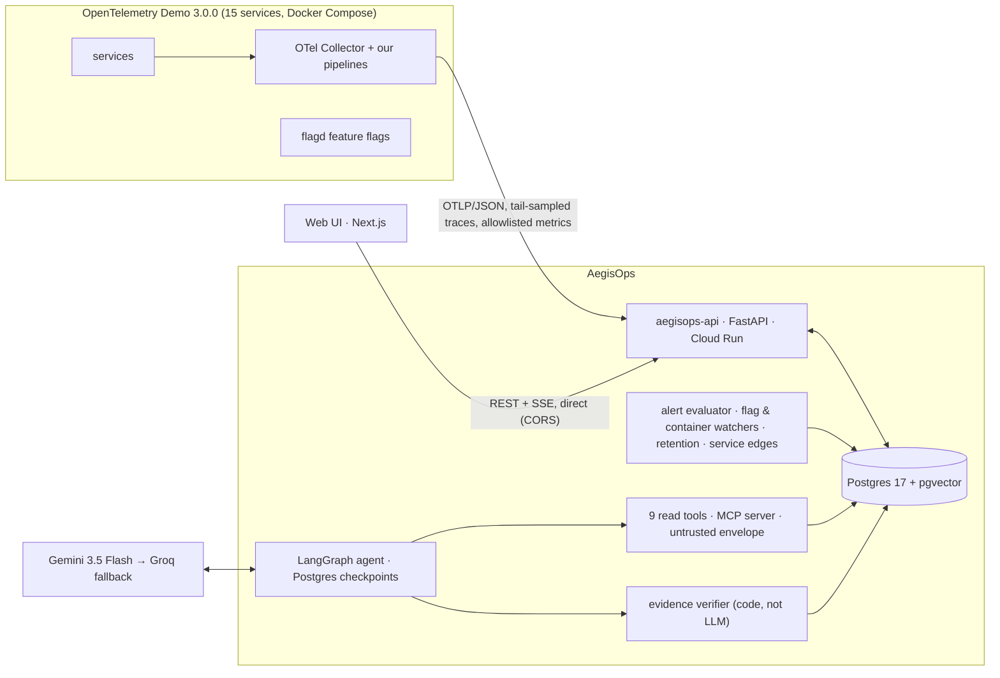

# AegisOps

**An autonomous incident-response engineer over real OpenTelemetry data.** It detects an incident in a 15-service system with deterministic rules, investigates it with an LLM agent over logs, metrics, traces and recent changes, **verifies every claim the agent makes against the telemetry store**, and proposes one of four safe operational fixes for a human to approve.

`agentic-ai` · `llm-agents` · `langgraph` · `mcp` · `opentelemetry` · `observability` · `aiops` · `sre` · `incident-response` · `root-cause-analysis` · `fastapi` · `postgresql`

> Status: **Week 6 of 13**. Features ahead of plan; dev-set captures S1–S6 and S8 done 22 Oct (S7 needs Kafka). Production runs on Cloud Run + Supabase in public mode (investigates and proposes, never executes). Live API: [`aegisops-api…run.app/livez`](https://aegisops-api-875836872466.asia-south1.run.app/livez). Public replay demo, benchmark table and video arrive with Milestone M1 (31 Oct) and M2 (22 Dec). Master plan: [`docs/PROJECT.md`](docs/PROJECT.md).

## What it does

- **Detects** incidents from rules over SQL aggregates (error rate, error bursts, p95 vs baseline, memory, CPU cores, Kafka lag), not from an LLM. Measured live: fault → open incident in **57 s**, zero false positives in warm-up.
- **Investigates** with a fixed LangGraph: triage → plan → investigate → correlate changes → root cause → verify evidence. Nine read-only telemetry tools, every result wrapped as untrusted data, ≤ 4 KB each.
- **Correlates what changed**: flag flips, deploys, restarts and scale events are recorded as they happen and scored by recency and dependency proximity.
- **Verifies before it speaks**: every cited trace, log, metric or change is checked against the store; numbers must be within ±20 %; unverifiable citations are dropped and confidence is scaled down. On its first real run the model claimed 0.86 with an invented metric name; the verifier returned 0.57 and said why.
- **Asks before it acts**: every investigation is a run with a live event stream; the agent proposes one of four fixes and pauses; a human approves or rejects over the API, and the policy decides when low-risk, high-confidence fixes may skip the human. Measured live: $0.004 per run at list prices.
- **Acts only after approval, and checks its work**: the approved fix runs through allowlisted, shell-free actions (flag revert, container restart); 90 s later the triggering rule is re-checked over post-fix data and the incident is resolved or marked failed. Every tool call, decision and action is audited.
- **Shows its working**: every run is one Langfuse trace: each graph node a span, each model call a generation with prompt, answer, model, tokens and cost, each tool call recorded; claimed vs verified confidence scored per run. Measured live on S1: 27 observations, $0.005, and the trace showed where the 112 s went (two Gemini → Groq fallbacks in `investigate`).
- **Stays inside budgets**: 15 tool calls, 60k tokens, 180 s per run; a breach still produces a partial report.
- **Watch it work in a browser**: an incidents page with one-click scenario replays, and an incident page that streams the investigation live: every step, the hypotheses, what the model claimed vs what survived the evidence check (and why each dropped citation was dropped), the proposed fix, and approve/reject for the operator. Works on a phone. The browser talks to the API directly, so per-visitor limits still see each visitor.
- **Safe to leave public**: visitors can replay a scenario and watch the agent live, but only one run at a time each and a daily cap overall (counted in Postgres across instances); past the cap they get the last finished run instead of an error. Visitor runs stop at the proposal: nothing executes.
- **Runs the same code live and in replay**: `aegis-scenario run S1` injects a fault, measures time-to-detect, reverts and captures the window; `aegis-scenario investigate S1` replays the agent on it with the clock frozen.

**Deliberately not in v1:** writing or merging code patches, Kubernetes, canary deploys, Slack/PagerDuty integrations, multi-tenancy, model fine-tuning.

## Architecture



Full picture, built vs planned: [`docs/ARCHITECTURE.md`](docs/ARCHITECTURE.md). Every design decision with alternatives: [`docs/adr/`](docs/adr/README.md).

## Results

Not yet. The benchmark (12 faults + 3 noise scenarios × 3 episodes × 4 agent variants × 2 models, four faults held out and run once) lands in Weeks 8–11 and is published unedited in `docs/EVAL.md`, with a "where it fails" page. Until then, one honest data point from the first real run on the payment-failure scenario:

| | Claimed by the model | After verification |
|---|---|---|
| Root cause | `config_regression` (flag flip) | unchanged |
| Confidence | 0.86 | **0.57** |
| Evidence | 3 citations | 2 kept, 1 dropped: invented metric name |

**First captures of the dev set (22 Oct, one episode each, live detection + one replay with Gemini 3.5 Flash → Groq fallback).** Not the benchmark: no repeats, no variants, and the scoring rules are still open (see the category column).

| Scenario | Fault | Detected in | Service | Category: agent (expected) | Fix proposed | Confidence claimed → verified |
|---|---|---|---|---|---|---|
| S1 | `paymentFailure` 100% | 69 s | ✅ payment | `config_regression` (`dependency_errors`) | – (23 Sep, before remediation) | 0.86 → 0.57 |
| S2 | `paymentUnreachable` | 37 s | ✅ checkout | ❌ `app_bug` (`dependency_down`) | ✅ revert the flag | 0.85 → 0.85 |
| S3 | `productCatalogFailure` | 55 s | ✅ product-catalog | `config_regression` (`app_bug`) | ✅ revert the flag | 0.85 → 0.85, partial |
| S4 | `cartFailure` 100% | 205 s | ✅ cart | `config_regression` (`datastore_failure`) | ✅ revert the flag | 0.78 → **0.52** (invented `cart_error_rate` dropped) |
| S5 | `recommendationCacheFailure` | 268 s (p95 rule) | ✅ recommendation | `config_regression` (`memory_leak`) | ✅ revert the flag | 0.95 → 0.95 |
| S6 | `adHighCpu` | 81 s (new CPU rule) | ✅ ad | `config_regression` (`cpu_saturation`) | ✅ revert the flag | 0.95 → 0.95 |
| S7 | `kafkaQueueProblems` | not run: needs the full demo (Kafka) | | | | |
| S8 | `emailMemoryLeak` 1000× | **missed** (crash loop, below) | | | | |

## Safety model

1. **Detection and verification are deterministic code.** The LLM proposes; code decides there is an incident and checks every claim (ADR-008).
2. **Telemetry is untrusted input.** Every tool result is wrapped in `<telemetry untrusted="true">` with escaped brackets; prompts state that content inside is never an instruction. A prompt-injection scenario (S13) is part of the benchmark.
3. **Actions are unreachable without approval.** Read tools are exposed over MCP; the four actions (toggle flag, restart, scale, rollback) are an in-process module reachable only from the `execute` node after `approval`, enforced by graph topology and a test (ADR-007).
4. **Least privilege everywhere.** Node-scoped tool allowlists; allowlisted action parameters with fixed argv, no shell; admin routes and ingest fail closed (ingest needs a bearer token in production, checked before the body is read); keyless cloud deploys via Workload Identity Federation restricted to this repository.
5. **Supply chain.** Lockfiles, Dependabot, dependency review (vulnerabilities + licences), CodeQL on code and workflows, secret scanning, actions pinned by SHA.

Details: [`docs/PROJECT.md` §11](docs/PROJECT.md) (threat model); `docs/SECURITY.md` in Week 13.

## Where it fails

Recorded as they happen, not curated later:

1. **Confidently wrong on day one.** With no change correlation, the model blamed a "connection refused" log and a `0 calls` reading for a service that had *no data*. Fixes: tools now say "no data" explicitly, changes are scored and handed to the model, and the verifier cuts confidence for unverifiable citations.
2. **Invented metric names.** `payment_error_rate` looks right and does not exist; dropped by the verifier.
3. **Detection has a traffic floor.** At the demo's default load the payment path sees ~5 calls/min; statistically confident detection within 60 s of the fault is at the edge. Documented in [Day 8](docs/learning/day-08-2026-09-20-alert-evaluator.md).

4. **A real citation can carry a wrong conclusion (S2).** The model said `app_bug` and "no recent configuration changes" while change correlation had scored the `paymentUnreachable` flip at 0.69. Its one citation (the error rate) was real, so the verifier kept 0.85. The verifier checks that evidence exists, not that the conclusion follows; the flag-revert rule in remediation still proposed the right fix.
5. **Every flag fault reads as `config_regression`.** All dev faults are injected with feature flags, and the model names the flag as the cause (true) instead of the mechanism the catalogue expects (`memory_leak`, `cpu_saturation`, …). Scoring has to decide which is right before the benchmark; recorded, not tuned away.
6. **A fast memory leak is a crash loop, and the memory rule misses it (S8).** At 1000× the email container is OOM-killed and restarted; its memory saw-tooths between 50 % and 88 %, so a 2-minute average never holds above 90 %. Candidates: a restart-rate rule or peak memory.
7. **Our own harness had bugs the captures found.** The runner set only a flag's default, but flagd evaluates targeting first, so S3's fault never fired (zero error spans; the "miss" was correct). S4 and S8 named variants the demo does not have. Docker's `container.cpu.utilization` behaves like a lifetime average on Docker Desktop/OrbStack, so CPU now comes from the usage counter ([ADR-025](docs/adr/ADR-025-cpu-from-usage-counter.md)).
8. **Infrastructure containers trip the memory rule.** opensearch and prometheus sit above 90 % of their limits and opened incidents during captures. Recorded in the fixtures as noise.

More in [`docs/learning/`](docs/learning/README.md), a day-by-day teaching log of everything built, every term, and what broke.

## Run locally

```bash
make install                                   # uv sync + git hooks
make db-up && make db-migrate                  # Postgres 17 + pgvector on :5433
make api                                       # http://localhost:8000/docs
make web-install && make web                   # UI on http://localhost:3000 (Operator → admin token to approve)
make demo-up                                   # pinned OTel Demo + our collector layer (~2.5 GB RAM)
make flag name=paymentFailure variant=100%     # inject a fault; an incident opens within ~60 s
```

Investigate an incident (needs `AEGIS_GEMINI_API_KEY` / `AEGIS_GROQ_API_KEY` in `.env`, or `--recorded` for a model-free replay):

```bash
uv run aegis-investigate --service payment --alert "high-error-rate: error_rate for payment = 0.83"
uv run aegis-investigate ... --recorded packages/agent/tests/cassettes/s1_payment_failure.yaml
uv run aegis-telemetry                         # the read tools as an MCP server (stdio)
curl -X POST localhost:8000/api/v1/incidents/<id>/runs -d '{}' -H 'content-type: application/json'   # start a run
curl -N localhost:8000/api/v1/runs/<run>/events   # live SSE stream; approve with POST /runs/<run>/approve
make check                                     # lint, types, 206 tests against Postgres (same as CI)
make web-check                                 # web lint, types, 24 unit + 6 Playwright tests
```

Run a scenario end to end and replay it:

```bash
uv run aegis-scenario list                     # S1–S8 dev, S9–S12 held-out, N1–N3 noise, S13 injection
uv run aegis-scenario show S5                 # one scenario's fault, expectations and timing
uv run aegis-scenario run S1 --admin-token $AEGIS_ADMIN_TOKEN   # fault → incident (TTD) → revert → capture
uv run aegis-scenario investigate S1           # replay the agent on the captured window, clock frozen
uv run aegis-scenario export S1                # bench/fixtures/S1.jsonl.gz for CI / the public demo
```

`make bench` (all scenarios × variants × models, scored) arrives in Week 9.

## At 10K services and 1,000 incidents a day

Shard ingest by service and sample harder at the collector; keep the span-metrics counters (they are the exact signal) and drop raw span retention to hours; put a queue and a worker pool in front of the agent instead of running it inside the SSE request (ADR-009 is a free-tier choice); per-tenant budgets and model routing; tiered storage (hot Postgres, cold object store) with `service_edges` and postmortems as the durable, small tables; read replicas for the tools. None of the agent code changes: the tool layer and the deployment do.

## In a real company

Today AegisOps and its target share one machine: the watchers read a local file and the local Docker socket, and actions use the same. A company will not open its network to a third party, so outside the laptop **every connection is opened from the company's side, carries only what it chooses to send, and can be revoked by the company** ([ADR-023](docs/adr/ADR-023-outbound-only-integration.md)):

| Need | Today (one machine) | In a company |
|---|---|---|
| Telemetry in | The demo's Collector posts to `/ingest` | Their own OTel Collector exports to `/ingest` with an ingest token; filtering and PII redaction happen in their Collector first. No account, no inbound access: OpenTelemetry is an open standard, and this is how hosted observability vendors onboard. |
| Changes in | Watchers poll a flag file and the Docker socket | Pushed: a CI/CD step posts each deploy; flag tools call a webhook on each flip; Kubernetes events arrive through their Collector |
| Notify a human | Web UI and API | Posts to a Slack incoming webhook or PagerDuty key **they** create (one channel, revocable); approve and reject buttons call back to the API |
| Act | In-process actions on the same host | A small runner **inside their network** polls for approved actions, runs only the four allowlisted ones with credentials that never leave, and reports back (the self-hosted CI runner / GitOps agent pattern) |
| Pull requests | None: remediation is operational, not code (ADR-005) | If ever: a GitHub App they install on chosen repositories; AegisOps opens a PR, their CI and reviewers decide |

Or **self-host**: it is Apache-2.0, so the whole system can run inside the company's network and no data leaves. The agent and verifier read the same four tables either way. Only who writes them changes.

## Tech stack

Python 3.13 · uv · FastAPI · SQLAlchemy 2 (async) · Alembic · Postgres 17 + pgvector · OpenTelemetry Collector (tail sampling, OTTL) · LangGraph 1.x with Postgres checkpoints · MCP SDK 2 · Gemini 3.5 Flash / Groq gpt-oss-120b via a 100-line router · pytest (206 tests) · Next.js 16 · React 19 · Tailwind v4 · Vitest · Playwright · ruff · mypy --strict · GitHub Actions (CI, CodeQL, dependency review, Dependabot, keyless Cloud Run deploy) · Docker · Cloud Run.

## Repository map

| Path | What |
|---|---|
| `apps/web/` | Next.js UI: incidents, live investigation over SSE, evidence panel, approvals |
| `apps/api/` | FastAPI service: ingest, health, incidents API, jobs (retention, service edges, flag & container watchers), alert evaluator |
| `packages/tools/` | Nine read tools, untrusted envelope, `aegis-telemetry` MCP server |
| `packages/agent/` | LangGraph graph, schemas, verifier, change correlation, model router, cassettes, `aegis-investigate` CLI |
| `packages/bench/` · `bench/scenarios.yaml` | Scenario catalogue, runner, capture, fixtures, `aegis-scenario` CLI |
| `infra/otel-demo/` | Collector layer and compose override for the pinned demo |
| `config/` | Alert rules, model routing, target-specific names |
| `docs/PROJECT.md` | The master plan: requirements, schedule, changelog |
| `docs/ARCHITECTURE.md` · `docs/RUNBOOK.md` · `docs/adr/` · `docs/learning/` | Living architecture, operations, decisions, day-by-day teaching log |

## Contributing

Contributions are welcome, from a typo to a new fault scenario. Start with [`CONTRIBUTING.md`](CONTRIBUTING.md): setup needs only Docker and Postgres (model calls in tests are replayed, so no API keys), and issues labelled [`good first issue`](https://github.com/lokeshbothra21/aegisops/labels/good%20first%20issue) say which files to touch and what done means. Commits are signed off under the [DCO](CONTRIBUTING.md#sign-your-commits-dco). Security problems go through [`SECURITY.md`](SECURITY.md), privately.

## License

Apache-2.0. Contributions are accepted under the same licence ([ADR-020](docs/adr/ADR-020-dco-not-cla.md)).
